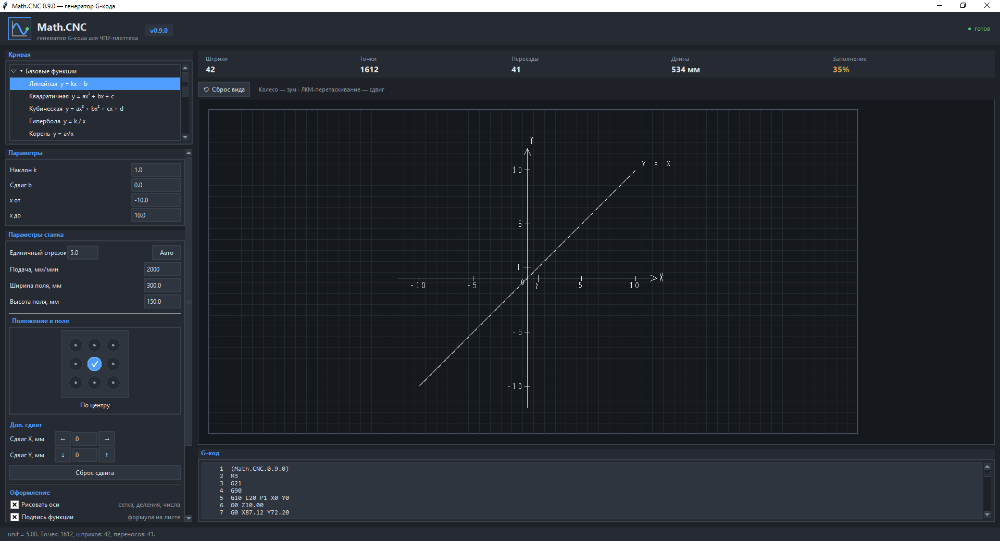

# MathCNC

[](https://www.python.org/downloads/)
[](LICENSE)
[](#)

A G-code generator that turns mathematical and parametric functions into
control commands for a CNC plotter running **GRBL** firmware. No external
dependencies — requires only Python 3.8+.

> Written by a 10th-grade student in the Engineering & Technology track
> at School No. 151, Krasnoyarsk, Russia, as a final-year project.

[Русская версия →](README.md)



---

## Table of contents

- [Features](#features)
- [How to run](#how-to-run)
- [Important: built for a specific plotter](#important-built-for-a-specific-plotter)
- [Hardware tips](#hardware-tips)
- [Examples](#examples)
- [Screenshots](#screenshots)
- [Changelog](#changelog)
- [Contributing](#contributing)
- [Author](#author)

---

## Features

### Graphical interface (tkinter)

- **Plots any mathematical or parametric function.**
  Default preset is a circle:
  ```
  x(t) = cos(t)
  y(t) = sin(t)
  ```
- **Correctly handles discontinuities** — e.g. a parabola with a
  removable singularity:
  ```
  x(t) = t
  y(t) = t**2 * (t-2)/(t-2)
  ```
  The point `(2; 4)` is marked with a circle and skipped in the G-code.
- **Built-in presets:** circle, heart, butterfly, rose, cardioid.
- **"Custom formula" mode** — any `x(t)` and `y(t)` from a safe set of
  functions (`sin`, `cos`, `tan`, `sqrt`, `abs`, `log`, `exp`, `pi`,
  `e` and others). Dangerous constructs (`import`, `exec`, `open`,
  `__builtins__`) are blocked at the expression compiler level.
- **G-code preview and simulation** before running on the machine:
  every line is visible, the currently executing line is highlighted,
  and there is an animated drawing simulation.
- **Pen-travel visualization** — see where the pen draws and where it
  just travels above the paper.
- **Layout settings:**
  - unit segment, mm
  - feed rate, mm/min
  - work-area width and height, mm
  - placement inside the field (3×3 widget)
  - additional axis offset
  - draw axes on/off
  - draw function label on/off
- **One-click `.gcode` export.**

### Console mode

- Fully functional CLI — works on desktops and mobile devices with
  Python 3.8+ installed.

---

## How to run

### Option 1: pre-built `.exe` (Windows)

1. Download `MathCNC.exe`.
2. Double-click to run. Python is not required.

### Option 2: from source

```bash
git clone https://github.com/slabnin-droid/MathCNC.git
cd MathCNC
python mathcnc.py            # GUI mode
python mathcnc.py --cli      # console mode
```

Requires **Python 3.8+**. No external packages — `tkinter` ships with
Python.

On Linux `tkinter` is sometimes installed separately:

```bash
sudo apt install python3-tk
```

### Option 3: mobile device

On a phone with Python installed, you can run the console mode:

```bash
python mathcnc.py --cli
```

The GUI (`tkinter`) may not open on mobile — that's expected; the CLI
mode is fully functional.

---

## Important: built for a specific plotter

Version 0.9.0 was created for the final project on the author's own
machine (controller **MKS DLS 32**). You can use the program on other
hardware, but keep three things in mind.

### 1. Z coordinates are hard-coded

```python
Z_DOWN = 0.0    # pen touches the table
Z_UP   = 10.0   # pen lifted
```

This is intentional — it prevents the user from crashing the machine by
entering a random number in the interface. Edit them in the constants
block at the top of `mathcnc.py`.

### 2. Set the initial Z position before starting a job

The pen will touch the table and start drawing from that exact point.
The machine does not "home" the Z axis by itself — wherever you place
the carriage, that becomes the contact point.

### 3. The `M3` command enables cooling, not the spindle

On the author's plotter, power is taken from the spindle pins of the
**MKS DLS 32** controller and routed through an LM buck converter to a
12 V fan. That's why `M3` in the G-code means **cooling on**.

**If you use a regular CNC mill with a pencil attachment — delete the
`M3` line from the G-code** or physically disconnect the spindle.
Otherwise the spindle will spin up together with "drawing".

---

## Hardware tips

- **Mount the pen on a spring.** Takes a minute to build from two pens.
  It compensates for uneven table surfaces and uneven pressure.
- **Gel pens.** Fewer line skips than ballpoint pens.

---

## Examples

Ready-to-run `.gcode` files live in the [`examples/`](examples/) folder:

- [`Heart.gcode`](examples/Heart.gcode) — heart (parametric curve)
- [`Sine.gcode`](examples/Sine.gcode) — sine wave
- [`Butterfly.gcode`](examples/Butterfly.gcode) — butterfly
- [`Parabola-hole.gcode`](examples/Parabola-hole.gcode) — parabola with
  a removable singularity (demonstrates discontinuity handling)

---

## Screenshots

| GUI mode | Drawing simulation |
|---|---|
| `docs/screenshot.png` | `docs/demo.gif` |

---

## Changelog

See [CHANGELOG.md](CHANGELOG.md) and [releases](../../releases).

---

## Contributing

This is an educational project, but it's open to improvements. Found a
bug or have an idea?

- **Bug** → open an [issue](../../issues) with reproduction steps.
- **Idea** → also an issue. Suggestions for new curve presets, support
  for other controllers, and additional export formats are welcome.
- **Pull request** → welcome. If the change affects program behavior,
  please add a short description of what and why.

---

## Author

**Daniil Slabnin** — 10th-grade student, Engineering & Technology track,
School No. 151, Krasnoyarsk, Russia.

Original repository: https://github.com/slabnin-droid/MathCNC
