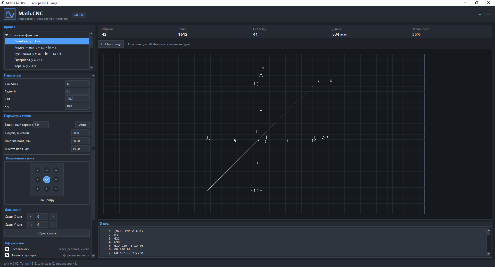

# MathCNC

[](https://www.python.org/downloads/)
[](LICENSE)
[](#)

Генератор G-кода, который превращает математические функции и
параметрические кривые в управляющие команды для ЧПУ-плоттера
с прошивкой **GRBL**. Внешних зависимостей нет - нужен только
Python 3.8+.

> Код написан учеником 10 класса инженерно-технологического направления
> школы № 151, г. Красноярск, в рамках итогового проекта.

[English version →](README.en.md)



---

## Содержание

- [Что умеет](#что-умеет)
- [Как запустить](#как-запустить)
- [ Важно: программа сделана под конкретный плоттер](важно-программа-сделана-под-конкретный-плоттер)
- [Советы по железу](#советы-по-железу)
- [Примеры](#примеры)
- [Скриншоты](#скриншоты)
- [Структура проекта](#структура-проекта)
- [История изменений](#история-изменений)
- [Участие и обратная связь](#участие-и-обратная-связь)
- [Автор](#автор)

---

## Что умеет

### Графический интерфейс (tkinter)

- **Строит графики** любых математических и параметрических функций.
  По умолчанию — окружность:
  ```
  x(t) = cos(t)
  y(t) = sin(t)
  ```
- **Корректно обрабатывает разрывы** — например, параболу с выколотой
  точкой:
  ```
  x(t) = t
  y(t) = t**2 * (t-2)/(t-2)
  ```
  Точка `(2; 4)` будет отмечена кружком и не нарисуется.
- **Готовые пресеты:** окружность, сердце, бабочка, роза, кардиоида.
- **Режим «Своя формула»** — любые `x(t)` и `y(t)` из безопасного
  набора функций (`sin`, `cos`, `tan`, `sqrt`, `abs`, `log`, `exp`,
  `pi`, `e` и другие). Опасные конструкции (`import`, `exec`, `open`,
  `__builtins__`) запрещены на уровне компилятора выражений.
- **Симуляция и просмотр G-кода** до запуска на станке: видна каждая
  строка, подсвечивается текущая команда, есть анимация отрисовки.
- **Просмотр траектории движения пера** — видно, где ручка рисует,
  а где просто переезжает над бумагой.
- **Настройка оформления:**
  - единичный отрезок, мм
  - подача, мм/мин
  - ширина и высота рабочего поля, мм
  - положение рисунка в поле (виджет 3×3)
  - дополнительный сдвиг по осям
  - рисовать ли оси координат
  - подписывать ли функцию
- **Быстрое сохранение** результата в формате `.gcode`.

### Консольный режим

- Полностью функциональный CLI — работает на компьютерах и мобильных
  устройствах с установленным Python 3.8+.

---

## Как запустить

### Вариант 1: готовый `.exe` (Windows)

1. Скачайте `MathCNC.exe`.
2. Запустите двойным кликом. Python на компьютер ставить не нужно.

### Вариант 2: из исходников

```bash
git clone https://github.com/slabnin-droid/MathCNC.git
cd MathCNC
python mathcnc.py            # графический режим
python mathcnc.py --cli      # консольный режим
```

Требуется **Python 3.8+**. Внешних пакетов нет — `tkinter` входит в
стандартную поставку Python.

На Linux `tkinter` иногда ставится отдельно:

```bash
sudo apt install python3-tk
```

### Вариант 3: мобильное устройство

На телефоне с установленным Python можно запустить консольный режим:

```bash
python mathcnc.py --cli
```

Графический интерфейс (`tkinter`) на мобильных устройствах может не
открыться — это нормально, CLI-режим полностью рабочий.

---

##  Важно: программа сделана под конкретный плоттер

Версия 0.9.0 выпущена для итогового проекта под станок автора
(контроллер **MKS DLS 32**). Работать с этой программой на другом
оборудовании можно, но учтите три момента.

### 1. Z-координаты зашиты константами

```python
Z_DOWN = 0.0    # перо касается стола
Z_UP   = 10.0   # перо поднято
```

Сделано специально, чтобы случайное число в интерфейсе не сломало
станок. Изменить можно в блоке констант в начале `mathcnc.py`.

### 2. Перед работой выставляйте начальное положение по оси Z

Именно в этой точке перо коснётся стола и начнёт рисовать график.
Станок не «ищет ноль» сам — где вы поставили каретку, там и будет
точка касания.

### 3. Команда `M3` включает охлаждение, а не шпиндель

В авторском плоттере питание взято с пинов шпинделя контроллера
**MKS DLS 32** и через понижающую плату LM подано на вентилятор
12 В. Поэтому `M3` в G-коде — это **включение охлаждения**.

**Если вы используете обычный ЧПУ-фрезер с карандашом — удалите
строку `M3` из G-кода** или физически отключите шпиндель. Иначе
шпиндель включится вместе с «рисованием».

---

## Советы по железу

- **Перо на пружине.** Делается за минуту из пружины от ручки и ещё
  одной ручки. Это компенсирует неровности стола и неровный нажим.
- **Гелиевые ручки.** Меньше вероятность пропусков в линии, чем
  у шариковых.

---

## Примеры

Готовые `.gcode`-файлы лежат в папке [`examples/`](examples/):

- [`heart.gcode`](examples/Heart.gcode) — сердце (параметрическая кривая)
- [`sine.gcode`](examples/Sine.gcode) — синусоида
- [`butterfly.gcode`](examples/Butterfly.gcode) — бабочка
- [`parabola-hole.gcode`](examples/Parabola-hole.gcode) — парабола 
  с выколотой точкой (демонстрирует обработку разрывов)

---

## Скриншоты

| Графический режим | Симуляция отрисовки |
|---|---|
| `docs/screenshot.png` | `docs/demo.gif` |

---


## История изменений

См. [CHANGELOG.md](CHANGELOG.md) и [релизы](../../releases).

---

## Участие и обратная связь

Проект учебный, но открыт для улучшений. Если нашли баг или есть
идея:

- **Баг** → создайте [issue](../../issues) с описанием шагов
  воспроизведения.
- **Идея** → тоже issue. Приветствуются предложения по новым
  пресетам кривых, поддержке других контроллеров, дополнительным
  форматам экспорта.
- **Pull request** → приветствуется. Если меняется поведение
  программы, добавьте, пожалуйста, короткое описание, что и зачем.

---


## Автор

**Слабнин Даниил Юрьевич** — ученик 10 класса
инженерно-технологического направления, школа № 151, г. Красноярск.

Исходный репозиторий: https://github.com/slabnin-droid/MathCNC
